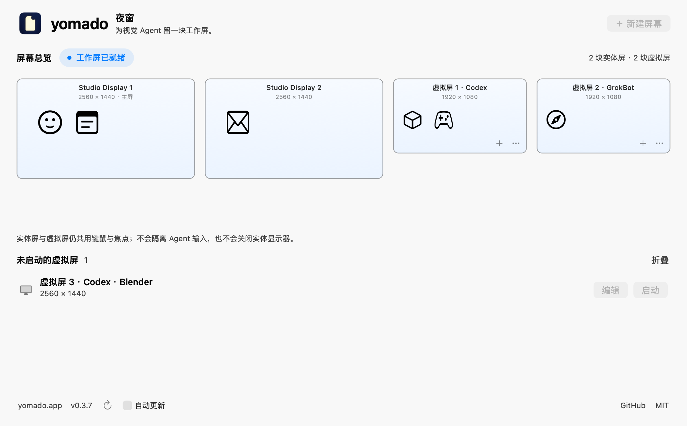

# yomado · 夜窗

A work screen for visual agents, designed to let physical screens rest.

[Website](https://yomado.app/) · [Download for Apple Silicon](https://github.com/chekusu/yomado/releases/download/v0.3.7/Yomado.zip) · [Release notes](https://github.com/chekusu/yomado/releases/tag/v0.3.7) · [简体中文](README.zh-CN.md) · [MIT license](LICENSE)

## See yomado in 60 seconds

Give Codex a virtual screen for visual workflows in Blender, Marvelous Designer, and other desktop apps—without needing an app-specific MCP integration.

[](https://chekusu.github.io/yomado/?lang=en)

**[▶ Watch with subtitles · 16 languages](https://chekusu.github.io/yomado/?lang=en)** · [English captioned MP4](https://yomado.app/media/captioned/yomado-film-en-wide-c1.mp4) · [中文字幕 MP4](https://yomado.app/media/captioned/yomado-film-zh-CN-wide-c1.mp4) · [Watch on yomado.app](https://yomado.app/watch/)

*60-second simulated demo with 16 subtitle languages and captioned landscape/portrait downloads. Chinese subtitles use River's Chinese narration; other subtitles use River's English narration.*

## Why yomado exists

yomado is built for **visual computer use**: Codex and other agents read screenshots, interpret the interface, and use the mouse and keyboard to operate desktop applications directly, without requiring an application-specific MCP integration. This matters for applications such as Marvelous Designer and Blender, especially when a workflow has no suitable MCP interface or needs interaction with a visible viewport, menu, or dialog.

These workflows still need a graphical desktop and a display surface for applications to render into. yomado provides a software virtual display for the windows an agent needs, with the goal of keeping those interfaces available while the Mac continues running and its physical monitors are off. Your existing agent tools handle screenshots, decisions, and input; yomado supplies the display. No hardware dummy plug or paid display utility is required.

## Let your agent set it up

You do not have to create a virtual screen or arrange its apps yourself. The included [yomado skill](skills/yomado/SKILL.md) guides a computer-use-capable agent through creating and naming a work screen, moving the task's windows into it, checking visual access, and returning them when finished.

> Use $yomado to prepare a virtual screen named “Codex · Blender” for this task. Move only this task's windows, verify that you can see and operate them, and restore them when finished.

For Codex, install the repository's `skills/yomado` folder in `$CODEX_HOME/skills` (default: `~/.codex/skills`); it is available from the next turn. Other agents can read the same `SKILL.md` using their skill mechanism. yomado and the agent's computer-use tools must be installed; you handle initial macOS permission grants. The skill uses the app's existing UI and shares the desktop's focus and input.


*AI-generated usage illustration. Agent work belongs on the virtual display; operation with physical monitors off is still under validation.*

**Experimental prototype:** Yomado uses private macOS APIs. Compatibility can change with a system update. The goal is to keep graphical work available with a physical monitor off; actual monitor standby, power savings, agent operation after physical output is disabled, and long unattended operation have **not** been validated.

## What it does

- Creates multiple named virtual displays, such as “Virtual display 1 · Codex” and “Virtual display 2 · GrokBot”, each with 1920 × 1080 or 2560 × 1440 and optional HiDPI.
- Groups the menu-bar menu by display, with hover submenus listing apps and visible-window counts, and an individual close action.
- Shows each physical and yomado display in desktop order, scaled to their logical desktop dimensions, with application icons inside each screen. Drag an icon into a virtual display, between virtual displays, or back to a physical display. Windows moved manually are detected too.
- Accepts a running app’s `.app` bundle from Finder as an explicit move of that app’s ordinary windows.
- Keeps naming and display settings in each virtual screen’s **…** menu; **New Display** opens a configuration sheet, and stopped screens appear below the overview with Start and Edit.
- Requests that the system and graphical desktop remain awake while virtual displays exist.

The virtual display belongs to your **existing login session**. It is not a separate operating system, user session, or isolated keyboard and mouse. Your agent and your own work share focus and input, so coordinate their use of the desktop. Yomado is not a remote desktop server or an agent: your existing tools still provide viewing, screenshots, and input.

## Control panel



*Native control-panel preview with example display data. This image does not validate target-app input or monitor standby.*

The compact panel presents **yomado · 夜窗**, a short tagline, and the screen layout with app icons inside each screen. App names and window counts are available on hover; controls appear as icons and menus. Valid drag targets highlight and their icons gently wiggle; Reduce Motion uses a static highlight. Click “New Display” to name a display and choose its resolution and HiDPI setting before creating and starting it. Saved displays that are not running appear below the overview, with direct Start and Edit actions. Use a running display’s menu to rename or close it; close it before changing resolution or HiDPI. “Add or Start a Virtual Display…” in the menu bar opens the control panel.

A local live test used the application chooser to move Calculator from a physical screen into Codex, then into GrokBot. A fresh screenshot on GrokBot showed the Calculator window, and typing `2 + 3` followed by Return produced `5`. Returning Calculator restored its original window position and size. These checks verify the chooser-based moves, virtual-to-virtual transfer, screenshot, keyboard input and explicit return for that app. A separate test with one virtual display also confirmed that closing it restored Calculator’s original position and size, then removed the virtual display. Direct icon dragging, closing one virtual display while another remains active, and the monitor-off workflow remain unverified.

## Build

Requires macOS and Xcode or the Command Line Tools. The app uses system frameworks only; there are no third-party runtime dependencies.

```sh
bash ./build.sh
```

Outputs:

```text
dist/Yomado.app
dist/Yomado.zip
```

The build script selects the active Xcode or Command Line Tools installation through `xcrun`. Set `YOMADO_DEVELOPER_DIR` to select another developer directory.

The native Apple Silicon build has been verified. The macOS 14 deployment target is a build setting, not a claim that every macOS 14+ system or Intel Mac is supported. An experimental Apple Silicon build is available in [GitHub Releases](https://github.com/chekusu/yomado/releases/tag/v0.3.7), with a SHA-256 checksum. Intel binaries are not supplied. The official v0.3.7 archive is signed by CHEKUSU INC. with Developer ID, notarized by Apple, and includes a stapled notarization ticket. Notarization is separate from Mac App Store review.

Local builds receive an **ad hoc signature** by default. Setting `YOMADO_SIGNING_IDENTITY` explicitly enables Developer ID Application signing with the hardened runtime and secure timestamps for both the app and its recovery helper. This signing step does not submit the app for notarization. See the [website distribution process](docs/distribution.md) for signing, Apple notarization, stapling and release checks. A release is described as notarized only after Apple accepts that exact build and its final download passes verification. Follow your Mac's normal security policies when choosing whether to run a local build.

## Use the virtual display

1. Extract the downloaded archive or build from source, then open `Yomado.app`. The panel shows the current physical screens and their visible apps.
2. Click “New Display”, enter a name, choose resolution and HiDPI, then create and start. Saved screens that are not running appear below the overview—start one directly, or edit its stopped settings. Use a running screen’s **…** menu to rename it for an agent. New virtual screens are appended to the right of the existing layout while physical outputs stay enabled. The app verifies extended mode, original main display, display modes, scale, rotation, positions and mirror relationships before admitting applications. If setup fails, it removes only the new screen and verifies recovery; unverified targets remain unavailable. Existing user mirror groups are preserved.
3. Drag **only the agent’s application icons** into the desired virtual screen. An icon represents that app’s ordinary windows on the source screen; moving it does not collect the same app’s windows from other screens. You can also move actual windows manually. Dropping a running `.app` from Finder explicitly selects that app’s ordinary windows across screens. Open the app before adding it.
4. Drag an app’s icon back into a physical screen to return its windows there, or use the icon’s return action. Dragging between physical screens is not provided; move the actual window for that operation. App counts reflect detected visible windows, not measured GPU activity or agent progress. Some apps reject Accessibility window positioning; yomado reports the failure.
5. Select the virtual screen in your viewing or agent tools, if supported. Verify a fresh target-app screenshot and an actual reversible input action before starting work.

Keep a physical display as the main display. Adjust the actual display arrangement in macOS Displays settings when needed. Resolution and HiDPI settings apply when starting a closed screen: HiDPI doubles each pixel dimension, so a 1920 × 1080 logical desktop becomes 3840 × 2160 pixels.

Changing displays, window positions, or scaling can invalidate an agent's saved coordinates. Refresh its screenshot and window state after each change. A successful screenshot does not by itself prove that keyboard or mouse input works.

Keep yomado running while using its displays. While its control panel is open, yomado shows a Dock icon and can participate independently in Stage Manager. Closing the panel returns it to menu-bar mode while its background workspaces keep running; reopen the same panel from the menu bar. Minimizing, hiding, or switching to another app does not close the panel, so the Dock icon remains. This behavior does not remove a launcher you have manually pinned to the Dock. Each display has its own app submenu and close action; **Quit yomado** closes all displays. Closing first attempts to return that display’s windows to physical screens and keeps the display if recovery cannot be confirmed. Sibling virtual displays continue running.

For ordinary apps moved through yomado, original placement is held in memory for this run and survives transfers between virtual displays. Dropping back on the original physical display restores that placement. Dropping on a different physical display centers the windows there; manually moved windows without a checkpoint are also centered on the chosen physical display. The icon’s general return action uses the recorded original display, or the current physical main display when no checkpoint exists. Friendly names and resolution preferences are saved locally. Displays are not automatically recreated at login or after an ordinary restart; a verified in-app update restores its saved workspace. Multiple displays still share keyboard, pointer and focus; they do not give agents independent input sessions.

Yomado does not change passwords, lock-screen policy, screen savers, or login settings. Its wake requests do not unlock a Mac. Screenshot and input permissions remain the responsibility of the tools that perform those actions.

## Share the mouse and keyboard

Agents should prefer background input that leaves your pointer, focus and front app alone: Accessibility actions and events delivered to the target app only. Some apps, such as 3D viewports and games, accept only real pointer and keyboard events. For those, an agent can ask yomado first:

```sh
./dist/Yomado.app/Contents/MacOS/Yomado --input request --agent "Codex" --reason "Orbit the Blender viewport" --seconds 120
./dist/Yomado.app/Contents/MacOS/Yomado --input status --lease <leaseID>
./dist/Yomado.app/Contents/MacOS/Yomado --input release --lease <leaseID>
```

yomado shows the request on the main screen with **允许** and **拒绝**; an unanswered request is refused after 60 seconds. While a lease is active, a notice stays at the top-right of the main screen, "Agent 正在使用你的鼠标键盘", with the agent's name, the time left and a **停止** button. A lease lasts 10 to 600 seconds and ends on release, expiry or Stop. After a release or expiry, yomado puts the pointer and front app back where they were; after Stop it leaves them with you. Each command prints one JSON line; exit status 0 means granted, released, active or idle.

yomado does not post input itself and cannot block an agent's tool. The lease is a permission and a visible notice: the [yomado skill](skills/yomado/SKILL.md) tells agents to check it before each batch of real input and to stop when it ends.

## Version and updates

The panel footer links to [yomado.app](https://yomado.app/), this GitHub repository and the MIT license, alongside the installed version. Click the refresh icon next to the version, or **Check and Install Updates…** (`检查并安装更新…`) in the menu-bar menu. The menu bar uses a transparent, monochrome silhouette of the night-window logo that follows the system appearance; the full app icon keeps its dark background.

Opening yomado again brings back its control panel, including after closing or minimizing it. Explicitly opening the panel recovers it onto a visible physical screen when one is available, without moving other apps or changing the display layout.

Automatic updates are enabled by default and can be switched off in the panel or menu bar. The refresh icon and **Check and Install Updates…** use the same in-app flow: download a compatible stable release, verify the signed feed and archive, install it, and reopen yomado. Experimental releases are not installed automatically. No GitHub account or browser download is required. Errors and progress appear in the panel; an update can be cancelled before installation starts.

Before restarting, yomado checkpoints active virtual screens and the exact existing windows inside them, then recreates those screens and restores those windows. It does not save documents or reconnect remote sessions. Dialogs, full-screen/minimized or unidentifiable windows, a pending dedicated WeChat recovery checkpoint, a virtual main display, missing window-control permission, or a changing layout postpone installation while the current app keeps running. After resolving the cause, check again to retry. Physical-display settings and unrelated application windows are not intentionally changed. Recovery refuses replacement windows or a different process, and stops if the display configuration changes. The private, short-lived checkpoint contains only window/process identities and geometry. See [update distribution and verification](docs/AUTOMATIC-UPDATES.md).

Older versions without the in-app updater need one ordinary upgrade to an updater-capable version. Subsequent stable releases can install through yomado.

## WeChat window recovery (experimental)

WeChat appears as an app icon inside its screen, alongside other applications. Moving it through yomado additionally checkpoints its main window’s physical-screen position and size. Use the icon’s return action or drag it back to a physical screen when login or a security prompt needs your attention. A pending WeChat safety checkpoint returns the window to its recorded original display, even when it is dropped on a different physical screen. Return WeChat to the physical desktop before moving it to another virtual screen.

If Accessibility permission is missing, a **lock icon** appears in the header and window movement is disabled. Click that icon to open the relevant page under **Privacy & Security**, then enable yomado yourself. This page is called **Accessibility** on earlier macOS versions, and **Device Control & Data Access** on macOS 27. If yomado is absent from the list, use **+** to select the app. The panel detects the updated permission automatically and hides the lock icon when access is granted. Permission is requested only when you click the icon; opening the settings page does not grant it.

Local builds are ad hoc signed by default. After rebuilding, macOS may retain a permission record tied to an older signature even though its switch appears enabled. If the lock icon remains after reopening the app, remove the old yomado entry in System Settings, add the current app with **+**, and enable it again. yomado does not reset or edit system permission records itself.

While that move is pending, a limited check can recognize supported security/login dialogs and return WeChat to its physical screen without clicking the prompt. Ordinary chat-window contents are never scanned. Some WeChat versions do not expose those dialogs in a recognizable form; automatic return is not guaranteed, so keep the manual return action available. An automatic failure pauses further attempts. Stopping or quitting yomado is held if a pending WeChat return fails.

The local checkpoint stores only the application ID, display UUID, window position/size and a recovery flag, under `~/Library/Application Support/dev.chekusu.yomado/`. It does not store chats, contacts, screenshots, passwords or authentication state. Returning a window cannot restore a logged-out account; complete login or verification yourself. If the original display is unavailable, recovery uses an available physical display and constrains the window to its bounds.

An earlier single-display WeChat move-and-return test restored its original placement. The current computer-use tool returned white WeChat window captures on both physical and virtual displays, so visual-input testing stopped. This does not establish working WeChat visual automation; real logout-triggered automatic recovery remains unverified.

## Physical monitors

The current control panel keeps physical display outputs enabled and does not expose the earlier physical-output trial. Creating or closing a virtual screen does not request that a physical monitor turn off.

For a later attended monitor-off test, first verify actual screenshots and reversible input in the target app while the physical monitors are on. The monitor can then be switched off using its own controls, while the Mac remains awake and the desktop session remains available. Check the physical monitor and test the target app again. This stage has not been validated; an available virtual display alone does not prove that the agent can keep working with the monitor off.

A black screenshot or a software-disabled output does not establish monitor standby or reduced power consumption. yomado cannot cut a monitor’s power or measure its consumption. The legacy recovery helper and CLI display tests remain in the source for development; they are not a physical-monitor power control in this panel.

## Diagnostics and tests

A read-only interface and display inventory check:

```sh
./dist/Yomado.app/Contents/MacOS/Yomado --diagnose
```

Physical display serial numbers are redacted by default. The optional `--include-device-identifiers` flag includes them for local diagnosis. Inventory output still describes your display setup; inspect and sanitize it before sharing.

The build script compiles, signs, and strictly verifies the staged bundle. The default signature is ad hoc; Developer ID signing requires an explicit `YOMADO_SIGNING_IDENTITY`. It does **not** launch the app or run display tests.

Pure policy tests can run without creating a display or opening an application:

```sh
bash ./test.sh
```

These tests check display placement, app/window ownership and recovery geometry, diagnostic redaction, WeChat checkpoint policies, and update checks. Update tests use a simulated network transport to cover version comparison, experimental releases, pagination, duplicate requests and failures without contacting GitHub. They do not exercise private APIs or prove live display configuration or cross-app input.

A separate hidden AppKit layout regression checks screen proportions, top alignment, inventory changes, scrolling and resizing. It also builds the control panel from synthetic displays to check that the overview cards fit the board without scrollers, with overlay and legacy scrollers, and that the window never grows to fit them. It requires a macOS WindowServer session, but does not inspect or move real application windows or create displays:

```sh
bash ./scripts/test-layout.sh
```

Render the control panel with example data, without reading or changing the display arrangement, inspecting WeChat or activating a window:

```sh
./dist/Yomado.app/Contents/MacOS/Yomado --preview-ui ./test-output/control.png running light
```

Create the output directory first. Preview states are `empty`, `running`, `multi` and the legacy `trial` fixture; appearances are `light` and `dark`. The legacy fixture does not expose an output-trial action in the current panel. The renderer needs macOS AppKit/WindowServer and draws its own hidden views. A preview is not a live display or target-app test.

The following tests require an interactive macOS login session. **Do not run them automatically, in build-only CI, or while someone else is using the desktop.** They create and remove temporary displays and apply layout restoration, so windows may move. Save work and close other Yomado instances before running them.

```sh
./dist/Yomado.app/Contents/MacOS/Yomado --self-test ./test-output/standard
./dist/Yomado.app/Contents/MacOS/Yomado --self-test ./test-output/hidpi hidpi
./dist/Yomado.app/Contents/MacOS/Yomado --watchdog-test ./test-output/watchdog \
  ./dist/Yomado.app/Contents/MacOS/YomadoWatchdog
```

Lifecycle self-tests exercise a temporary virtual display, its dimensions, an app-owned AppKit view, virtual-output disable/re-enable, removal, and attempted layout restoration. The watchdog test uses a disposable process and a temporary virtual recovery target. Neither test deliberately disables a physical output.

Generated view images are **not** screenshots of Blender, Marvelous Designer, or another target application. Passing these tests does not validate an agent's input, physical monitor standby, energy savings, or unattended operation. Test receipts can contain display metadata; review them before sharing.

## Implementation

`bridge/YMDisplayTopology.*` handles bounded display transactions and fail-closed verification; synthetic backend tests do not change live displays. DisplayLink hardware compatibility still requires testing on the specific dock, driver and macOS version.

`app/Yomado.m` contains the AppKit app and test entry points. `app/ControlUI.*` and `app/AppWorkspaceView.*` draw the native screen layout, application icons and drag targets; `app/AppWorkspace.*` manages ordinary app window ownership and original placement; `app/WindowRecovery.*` and its pure policy header handle the opt-in WeChat window checkpoint. `app/Watchdog.m` contains the recovery helper; `bridge/VDVirtualDisplay.*` wraps the virtual-display interface. The application namespace is `dev.chekusu.yomado`.

The implementation uses private `CGVirtualDisplay` classes and dynamically discovers `CGSConfigureDisplayEnabled` / `SLSConfigureDisplayEnabled`. Feature availability is checked at runtime. Apple does not promise compatibility for these interfaces.

Contributions should preserve the distinction between creating a virtual display, changing display topology, and verifying real target-app operation. Keep diagnostics free of secrets and personal workflow data, and avoid running display-changing tests in automation.

## License

The [logo and usage illustration](docs/images/PROMPTS.md) were created with image generation; their prompts are included for reference.

[MIT](LICENSE).
